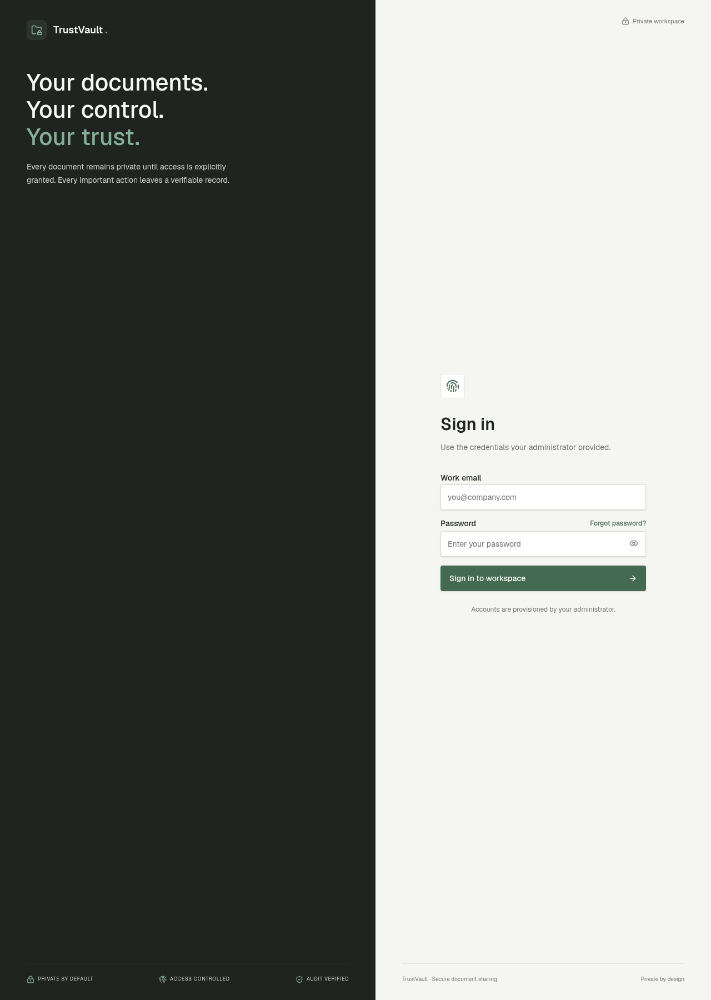
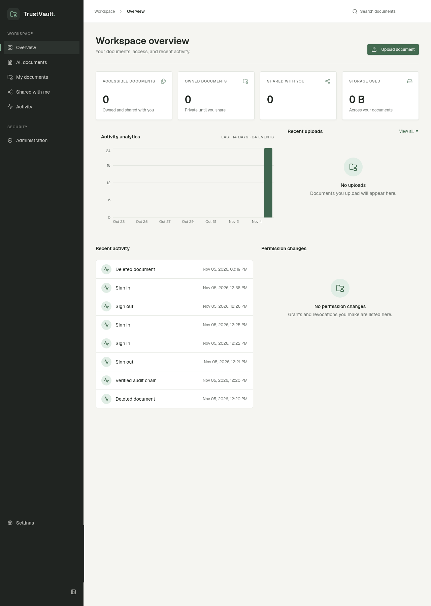

# TrustVault

**Secure document management and sharing — private by default, access controlled, audit verified.**

TrustVault is a full-stack web application for sharing sensitive documents
inside an organization. Every document stays private until its owner
explicitly grants access, every grant can be revoked instantly, and every
security-relevant action is recorded in a tamper-evident, hash-chained audit
log.



## Features

- **Role-based access control** — administrators, owners, and viewers with
  clearly separated capabilities.
- **Document-level permissions** — per-user read or edit grants on each
  document, with instant revocation.
- **Secure downloads** — file content is served only through 60-second
  signed URLs, issued after a fresh permission check. The storage bucket is
  private; there is no public or client-side read path.
- **Tamper-evident audit trail** — an append-only, hash-chained log of
  logins, uploads, downloads, permission changes, and administrative
  actions, with one-click chain verification.
- **Admin-provisioned accounts** — no public sign-up. A one-time bootstrap
  creates the first administrator; after that, only admins create accounts.
- **Account controls** — deactivation blocks sign-in and access immediately
  while preserving the user's audit history.
- **Document management** — upload (25 MB limit, SHA-256 checksums), edit
  metadata, preview, organize by category, search and filter.
- **Premium, accessible UI** — warm off-white, charcoal, and forest-green
  identity; dark mode; responsive with a collapsible sidebar;
  reduced-motion support.



## Technology stack

| Layer | Technology |
| --- | --- |
| Frontend | React 19, TanStack Router/Query, Tailwind CSS v4, shadcn/ui |
| Full-stack framework | TanStack Start v1 (Vite 7, SSR, server functions) |
| Backend | Lovable Cloud (Supabase-compatible: Postgres + RLS, Auth, Storage) |
| Database access | Drizzle schema + SQL migrations, security-definer functions |
| Testing | Vitest, Testing Library |

## Architecture

```text
Browser (React)                Server functions              Backend
───────────────                ──────────────────            ─────────────
read-only queries ────────────▶ (publishable key, RLS-enforced)
writes ──▶ server function ──▶ verify session
                               re-check authorization ──────▶ has_role /
                               via DB functions               doc_access_level
                               privileged write ────────────▶ Postgres / Storage
                               write audit entry ───────────▶ audit_logs
                               (append-only, hash-chained)
```

The browser never writes directly and never reads file content directly:
all writes and all content URLs go through server functions that re-check
authorization server-side. See [docs/ARCHITECTURE.md](docs/ARCHITECTURE.md)
for the full picture and [THREATS.md](THREATS.md) for the threat model.

## Getting started

### Prerequisites

- Node.js 20+ (or Bun)
- A backend: **Lovable Cloud** (recommended) or a compatible Supabase
  project. Cloning this repository does **not** include a backend — you
  connect your own.

### Install

```sh
git clone <repository-url>
cd trustvault
npm install
cp .env.example .env   # fill in your backend URL and keys
npm run dev
```

Then apply the database schema (`drizzle/migrations/`), create the private
`documents` storage bucket, and disable public sign-up — the complete,
step-by-step guide is in [docs/INSTALLATION.md](docs/INSTALLATION.md).

### First administrator

Visit `/setup` while no administrator exists. The bootstrap works exactly
once — it closes permanently as soon as any admin exists, so there is no
race and no default credentials. Afterwards, administrators create all
further accounts from **Administration → Create account**.

### Roles at a glance

| | Viewer | Owner | Admin |
| --- | --- | --- | --- |
| Read shared documents | ✓ | ✓ | with explicit grant |
| Upload / edit / delete own documents | | ✓ | |
| Share and revoke | | ✓ | |
| Manage users and roles | | | ✓ |
| View and verify audit log | | | ✓ |

### Sharing workflow

1. An **owner** uploads a document (private by default).
2. The owner opens it and grants a **viewer** read or edit access.
3. The viewer sees it under **Shared with me** and can download or preview
   it.
4. The owner revokes the grant — access ends immediately (signed URLs live
   at most 60 seconds).
5. Every step is in the audit log, visible under **Activity** (and in full
   to admins).

## Security

TrustVault's security model in short:

- Server-side authorization on every write and every content request.
- Read-only browser access to application tables (row-level security).
- Private storage; 60-second signed URLs only.
- Append-only, hash-chained audit log with built-in verification.
- No public sign-up; no default credentials; one-time admin bootstrap.

Full details: [docs/SECURITY_MODEL.md](docs/SECURITY_MODEL.md).
Report vulnerabilities privately per [SECURITY.md](SECURITY.md) — never in a
public issue. TrustVault is **not** security-certified.

## Testing

```sh
npm run test    # unit + routing tests (Vitest)
npm run lint    # ESLint
npm run build   # production build
```

Access-rule unit tests live in `src/lib/access.test.ts`; routing tests in
`src/test/`. Changes to permissions, roles, or limits must come with tests
(see [CONTRIBUTING.md](CONTRIBUTING.md)).

## Deployment

The supported path is publishing through Lovable (one click, backend
included). See [docs/DEPLOYMENT.md](docs/DEPLOYMENT.md) for the release
checklist. Docker/self-hosting has not been implemented or tested — the
requirements for porting are documented, and contributions are welcome.

## Documentation

- [Architecture](docs/ARCHITECTURE.md)
- [Installation](docs/INSTALLATION.md)
- [Deployment](docs/DEPLOYMENT.md)
- [Security model](docs/SECURITY_MODEL.md) · [Threat model](THREATS.md)
- [API (server functions)](docs/API_DOCUMENTATION.md)
- [Database](docs/DATABASE.md)
- [FAQ](docs/FAQ.md)
- [Changelog](CHANGELOG.md) · [Build prompts](PROMPTS.md)

## Contributing

Contributions are welcome — read [CONTRIBUTING.md](CONTRIBUTING.md) first,
and note the security invariants that PRs must not break. Please follow the
[Code of Conduct](CODE_OF_CONDUCT.md).

## Known limitations

- Not end-to-end encrypted — the server can read content to serve it.
- No two-factor authentication yet.
- 25 MB per-file limit.
- Tied to a Supabase-compatible backend; no tested self-hosting path.

## License

[MIT](LICENSE) © 2026 TrustVault contributors.
